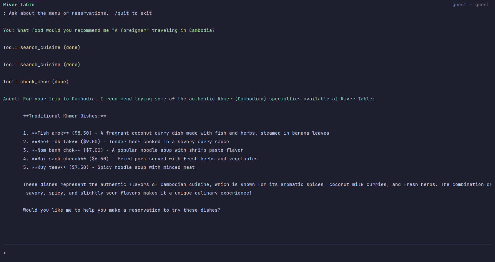
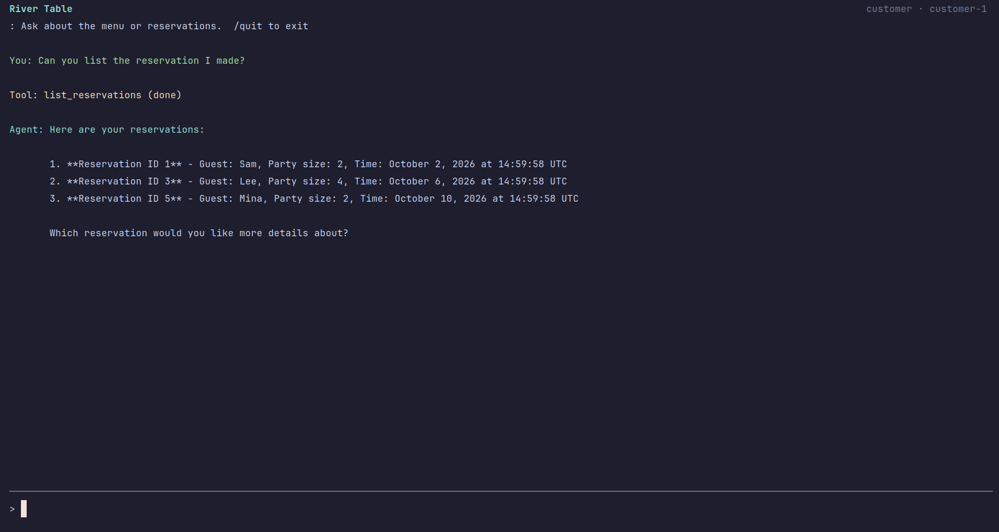
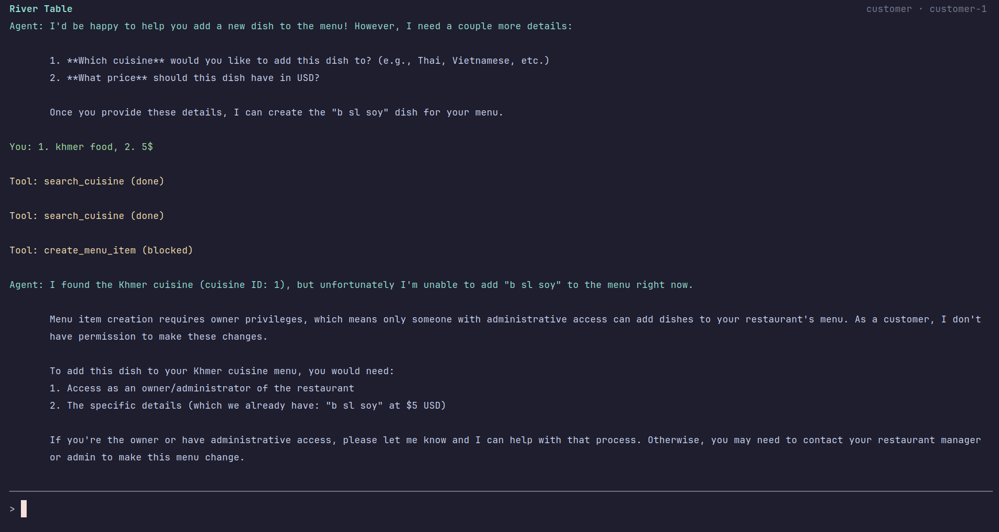
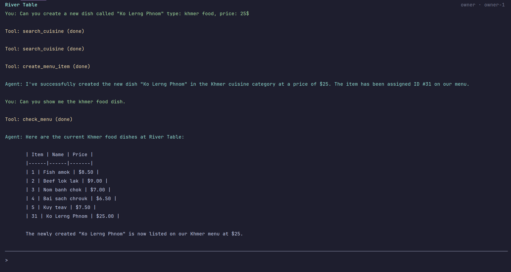

# Restaurant Agent

## Project Overview

Restaurant Agent is a terminal chat application for **River Table**, one restaurant in Phnom Penh. Guests can explore its cuisines and menus; customers can make reservations; the owner can edit menu items and manage reservations. A local model served by LM Studio handles the conversation, SQLAlchemy manages the SQLite database, and a Python harness controls which proposed tool calls may run.

## Setup

1. **Install the prerequisites.** Use Python 3.10 or newer and install [uv](https://docs.astral.sh/uv/getting-started/installation/)

2. **Install the project dependencies.** Open a terminal in this repository's root directory, the one containing `pyproject.toml`, and run:

   ```bash
   uv sync
   ```

3. **Create your local configuration.** Copy the template, then edit `.env` if your model ID or server address differs:

   ```bash
   cp .env.example .env
   ```

   On Windows Command Prompt, use `copy .env.example .env`. Check the [configuration values](#configuration-values) below, especially the model ID returned by the server's `/v1/models` endpoint. Shell environment variables override `.env` values.

4. **Run the app.** From the same directory, start the terminal chat:

   ```bash
   uv run restaurant-agent
   ```

   The app creates and seeds `data/restaurants.sqlite3` on first run with **one restaurant, five cuisines, 25 menu items, and six future reservations**. Type `What dishes are on the Khmer menu?` and press Enter to try it. Answers stream as they are generated; tool names appear only when the model calls a tool. Type `/quit` to exit.

## Configuration Values

The `.env` file uses one `NAME=value` setting per line. These are the values in `.env.example`:

| Setting              | Example value              | What it controls                                                                                                                            |
|----------------------|----------------------------|---------------------------------------------------------------------------------------------------------------------------------------------|
| `BASE_URL`           | `http://localhost:1234/v1` | Address of the local OpenAI-compatible API. Keep `/v1`; change the host or port if your server uses another address.                        |
| `CHAT_MODEL`         | `qwen3.5-4b`               | Exact model ID sent to the server. Use the ID shown by `curl http://localhost:1234/v1/models`.                                              |
| `RESTAURANT_DB_PATH` | `data/restaurants.sqlite3` | SQLite database file. The app creates and seeds it if it does not exist. Relative paths start from the directory where you run the command. |
| `RESTAURANT_ROLE`    | `guest`                    | Sample session's permission level: `guest`, `customer`, or `owner`.                                                                         |
| `RESTAURANT_USER_ID` | `guest`                    | Sample session's identity. Use `guest`, `customer-1` or `customer-2`, or `owner-1` with the matching role.                                  |

`RESTAURANT_ROLE` and `RESTAURANT_USER_ID` must be changed together when testing another role. They simulate a signed-in user; they are not LM Studio credentials. The next section shows the correct pairs.

Start LM Studio's local server and load a model before running the app. If a request cannot connect, check that `BASE_URL` matches the running server. Check `curl http://localhost:1234/v1/models` and set `CHAT_MODEL` to an ID it returns. Existing `.env` files using `LM_STUDIO_BASE_URL` and `LM_STUDIO_MODEL` still work; the new names take precedence when both are set.

## Test Each Role

Set **both** `RESTAURANT_ROLE` and `RESTAURANT_USER_ID` in `.env`, then restart `uv run restaurant-agent`. The TUI header shows the active role and user ID. The seeded sessions and useful prompts are:

| Role     | `RESTAURANT_ROLE` | `RESTAURANT_USER_ID` | Prompt to try                           |
|----------|-------------------|----------------------|-----------------------------------------|
| Guest    | `guest`           | `guest`              | `What dishes are on the Khmer menu?`    |
| Customer | `customer`        | `customer-1`         | `Show my reservations.`                 |
| Owner    | `owner`           | `owner-1`            | `List all reservations at River Table.` |

For a quick test without editing `.env`, set the pair for one command:

```bash
RESTAURANT_ROLE=customer RESTAURANT_USER_ID=customer-1 uv run restaurant-agent 
RESTAURANT_ROLE=owner RESTAURANT_USER_ID=owner-1 uv run restaurant-agent
```

Use `customer-2` with the customer role to see a different customer's reservations. The role and ID are sample session values; an application integrating the harness must get them from authentication.

## Project Structure

```text
.
├── data/
│   ├── sample_data.py        Cuisines, dishes, and reservation seed records
│   └── seed.py               Standalone database seeder
├── src/pratice_harness/
│   ├── main.py               App entry point and .env loading
│   ├── tui.py                Terminal chat screen
│   ├── agent.py              Model requests and tool-call loop
│   ├── harness.py            Role checks and tool argument validation
│   ├── schemas.py            Tool input schemas and model-facing definitions
│   ├── models.py             SQLAlchemy table models
│   ├── tools.py              Menu and reservation database operations
│   └── seed_data.py          Loads sample records for source and wheel installs
```

`data/restaurants.sqlite3` is created on first run and is ignored by Git. The editable `.env` file is also local; `.env.example` is the copyable template.

## Available Tools

| Tool                 | What it does                                                                             |
|----------------------|------------------------------------------------------------------------------------------|
| `search_cuisine`     | Finds one of River Table's cuisines by name.                                             |
| `check_menu`         | Lists dishes, prices, and item IDs for a cuisine.                                        |
| `create_menu_item`   | Adds a dish to a cuisine.                                                                |
| `update_menu_item`   | Changes a dish's name or price.                                                          |
| `delete_menu_item`   | Removes a dish.                                                                          |
| `make_reservation`   | Creates a reservation for a named guest, party size, and time.                           |
| `list_reservations`  | Lists the current customer's or owner's reservations; can filter past or upcoming dates. |
| `update_reservation` | Changes a reservation's guest name, party size, or time.                                 |
| `delete_reservation` | Cancels a reservation.                                                                   |

## Agent Loop

```text
User request → model chooses an answer or proposes a tool
             → harness validates arguments and checks permission
             → allowed tool runs against SQLite
             → tool result or rejection becomes an observation
             → model sees the observation and decides again
             → final answer, or stop after five model iterations
```

The TUI keeps conversation history during a session. For a cuisine question, the model can call `search_cuisine` and then `check_menu`. The application supplies the session identity to the harness on every call; the model cannot choose its own role or user ID.

## Permission Rule

| Action                               | Guest | Customer              | Owner                           |
|--------------------------------------|-------|-----------------------|---------------------------------|
| Search cuisines and read menus       | Yes   | Yes                   | Yes                             |
| Create a reservation                 | No    | Yes                   | Yes                             |
| List, update, or cancel reservations | No    | Own reservations only | All reservations at River Table |
| Create, update, or delete menu items | No    | No                    | Yes                             |

The seeded owner ID is `owner-1`; sample customer IDs are `customer-1` and `customer-2`.

## Safety

- Pydantic validates model-supplied arguments before execution. Cuisine and item IDs must be positive integers; reservation party sizes must be 1–8; reservation times need a timezone and must be in the future. Menu prices must be positive with at most two decimal places.
- The harness checks role and record ownership in Python before writes. Customer IDs come from the session, never from model arguments. Database operations use SQLAlchemy models and sessions.
- Denied calls, invalid arguments, unknown tools, and tool failures produce structured error observations. Unexpected tool exception details are hidden from the model.
- Each user message is limited to five model iterations. If the model does not finish, the agent returns a diagnostic status message.

## Example Run
These are the test cases screenshots
#### Guest user

---
#### Customer
Good test case


Bad test case (only owner can create a new dish)


#### Owner

